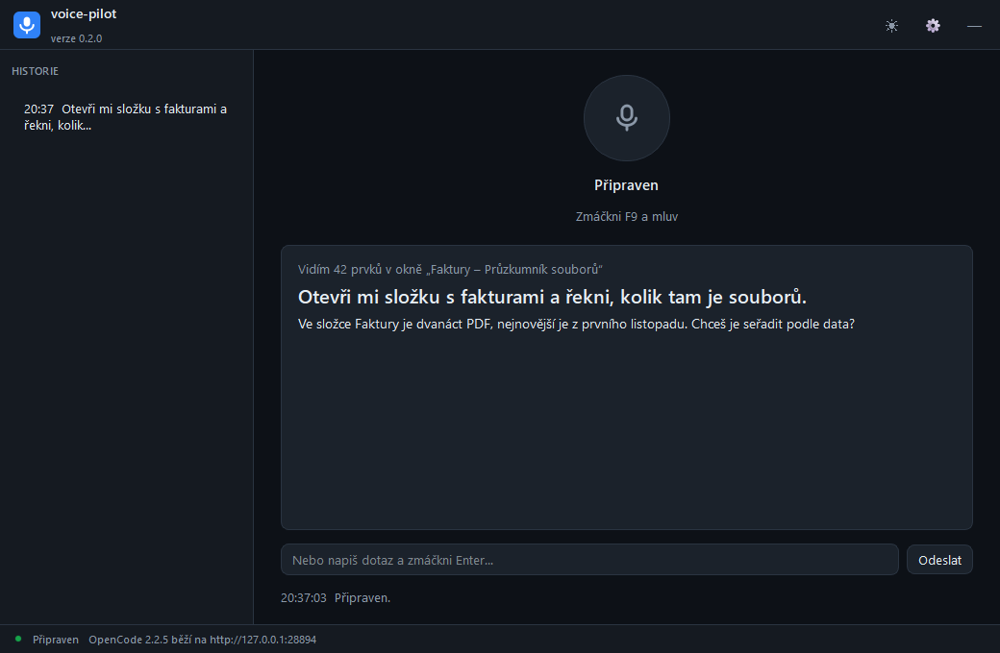

# voice-pilot

Hlasový asistent pro Windows. Mluvíš česky, on se podívá na obrazovku a odpoví nahlas.



Zatím **kouká a mluví** — přečte okna, tlačítka a texty na obrazovce a řekne, co vidí.
Klikání myší je připravené na další krok (viz [Co dál](#co-dál)).

## Jak to funguje

```
mikrofon → Whisper na GPU → text
                             ↓
                UI Automation → popis obrazovky
                             ↓
                       OpenCode → odpověď
                             ↓
                     edge-tts → reproduktory
```

**Mozek není v projektu.** Volá se lokálně běžící OpenCode služba
(`127.0.0.1:28894`), takže se používají tvoje stávající přihlášení k modelům.
Žádný API klíč se neukládá.

**Oči nejsou screenshot.** Windows UI Automation dá přesné názvy tlačítek,
polí a textů i s jejich souřadnicemi — v češtině a bez OCR. Každý prvek
dostane číslo, takže v dalším kroku půjde říct „klikni na `[7]`“ a asistent
nemůže kliknout na něco, co mu neukážeme.

## Instalace

### Instalátor

Stáhni `voice-pilot-<verze>-setup.exe` z [Releases](../../releases) a spusť ho.
Nepotřebuje správce, instaluje se do `%LOCALAPPDATA%\VoicePilot`.

Instalátor **přibaluje vlastní Python i všechny balíčky**, takže nepotřebuje
Python v systému ani internet. Instalace trvá asi minutu a loguje se do
`install.log`.

CUDA knihovny pro GPU (1,3 GB) se stahují až během instalace a jen když
najde NVIDIA kartu. Bez nich aplikace funguje, jen je přepis ~6× pomalejší.

### Ze zdrojů

```bash
git clone https://github.com/erikibolya/voice-pilot.git
cd voice-pilot
install.bat
```

### Pro vývoj

```bash
python -m venv .venv
.venv\Scripts\python.exe -m pip install -r requirements.txt
.venv\Scripts\python.exe -m pip install nvidia-cublas-cu12 nvidia-cudnn-cu12
```

CUDA balíčky jsou potřeba, aby Whisper běžel na grafice. Bez nich se aplikace
přepne na CPU a bude ~6× pomalejší (ale funguje). Model `large-v3` (~3 GB) se
stáhne při prvním použití.

## Ovládání

Aplikace běží v okně i v systémové liště.

| | |
|---|---|
| **drž klávesu** | nahrává, dokud držíš; puštěním odešleš |
| **klik na mikrofon** | totéž (klikni pro start, klikni pro stop) |
| **psaný dotaz** | napiš do pole dole a zmáčkni Enter |
| **zavření okna** | skryje do lišty, aplikace běží dál |
| **dvojklik na ikonu** | vrátí okno |
| **Ukončit v liště** | skutečné ukončení |

Výchozí klávesa je **F9**, ale dá se změnit v nastavení — klikni na tlačítko
a stiskni, co chceš. Samotné písmeno se nepovolí (spouštělo by se psaním);
povolená je funkční klávesa, speciální klávesa, nebo kombinace s modifikátorem.

Dokud držíš klávesu, **dole uprostřed obrazovky pulzuje pruh** s nápisem
DIKTUJI — je vidět, že mikrofon poslouchá, i když se nedíváš do okna.

Pípnutí označuje začátek a konec nahrávání, takže se nemusíš dívat do okna.

## Klikání s potvrzením

Model **nesmí** říct „klikni na souřadnice 812, 431“. Smí jen odkázat na
číslo prvku, který jsme mu ukázali ve snímku obrazovky. Co v seznamu není,
se nikdy neprovede.

Každá akce, která **nejde vzít zpět**, se nejdřív nahlas ohlásí a čeká na
potvrzení. Běžné kliknutí proběhne rovnou — ptát se u každého kliknutí je
otravné a zdržuje.

Nevratné věci (smazat, odeslat, zaplatit, odinstalovat) se poznají i podle
**názvu tlačítka**, ne jen podle textu.

| | |
|---|---|
| **Ctrl+Alt+Enter** | provést |
| **Ctrl+Alt+Esc** | zrušit |
| panel | vpravo dole, **nebere fokus** — psaní zůstane v aplikaci, kterou ovládáš |
| po 45 s | platí „ne“ |

Když se chystám něco provést, **rozsvítí se rám kolem všech obrazovek**
s nápisem PILOT OVLÁDÁ POČÍTAČ. Je vidět, že počítač zrovna není jen tvůj —
stejná myšlenka jako u Claude, když přebírá kontrolu.

Když prvek neumí UI Automation kliknout a musí se klikat na souřadnice,
ověří se nejdřív, že je pořád na stejném místě. Když se posunul, nic se
nestane.

## Odezva

Naměřeno na RTX 3070, `python bench.py`:

| Krok | Čas |
|---|---|
| Přepis 5 s řeči na GPU | 1,1 s |
| Čtení obrazovky | 0,9 s — běží **souběžně** s přepisem |
| Model | 1,4–2,8 s — kolísá podle vytížení poskytovatele |
| Hlas do prvního zvuku | 1,1 s — streamuje se za pochodu |
| **Celkem po domluvení** | **~4,5 s** |

**Není to Python.** Práci dělají knihovny v C++ (CTranslate2 pro Whisper,
UI Automation, miniaudio); Python je jen lepidlo mezi nimi, jeho vlastní režie
je v jednotkách milisekund. Přepsat to do Rustu by ušetřilo zlomek sekundy.

Kde čas opravdu je: ~0,9 s stojí navázání spojení s hlasovou službou
Microsoftu (proto i jedno slovo trvá skoro sekundu), zbytek je model
a samotné generování řeči. `beam_size` ani velikost promptu s tím nehnou —
změřeno.

### Který hlas

| | edge-tts (Microsoft) | Piper (lokální) |
|---|---|---|
| První zvuk | 1,1–2,2 s | **0,25 s** |
| Kvalita | přirozená | robotičtější, ale srozumitelná |
| Internet | potřeba | ne |
| Cena | zdarma | zdarma |
| Velikost | — | 63 MB model + 20 MB balíček |

Přepíná se v nastavení (Řeč) nebo `tts_engine` v `config.json`.
Piper se doinstaluje přes `run.py --setup-piper`, výchozí je `auto`
(edge, a když vypadne net, přepne na Piper). Model se načítá na pozadí
při startu, takže první odpověď nečeká.

**Proč není lepší lokální hlas:** kvalitnější lokální modely existují, ale
jsou řádově těžší — na tuhle grafiku by se počítaly déle než cloud, takže
by to bylo pomalejší, ne rychlejší. Piper je z otevřených českých hlasů
jediný, který je zároveň rychlý a zdarma.

## Nastavení

V okně přes ozubené kolo: klávesa, hlas, model a velikost modelu pro přepis.
Ukládá se do `config.json` vedle aplikace.

| Klíč | Význam |
|---|---|
| `hotkey` | klávesa pro nahrávání, výchozí `f9` |
| `voice` | `cs-CZ-VlastaNeural` (žena) nebo `cs-CZ-AntoninNeural` (muž) |
| `model_id` | `deepseek-flash` (rychlý) nebo `deepseek-v4-pro` (přesnější) |
| `whisper_model` | `large-v3`, `medium`, `small` |
| `tts_engine` | `auto` (edge → piper), `edge`, `piper` |

## Aktualizace

Aplikace se při startu zeptá GitHubu na nejnovější vydání. Když je novější,
v hlavičce se objeví odznak a v patičce tlačítko, které instalátor stáhne
a spustí. Stav se dá ověřit i z terminálu:

```bash
run.py --check-update
```

Vydání vzniká pushnutím tagu `v*.*.*` — GitHub Actions sestaví instalátor
a přiloží ho k vydání.

## Testy

```bash
.venv\Scripts\python.exe -m pytest -q                      # vše
.venv\Scripts\python.exe -m pytest -q -m "not slow"        # bez modelu
.venv\Scripts\python.exe -m pytest -q -m "not slow and not desktop"   # co běží v CI
```

Přehled, co je čím pokryté, je v [docs/TESTING.md](docs/TESTING.md).

## Sestavení instalátoru

```bash
powershell -ExecutionPolicy Bypass -File tools\build_installer.ps1
```

Výsledek je `dist\voice-pilot-<verze>-setup.exe`. Potřebuje
[Inno Setup 6](https://jrsoftware.org/isinfo.php) (`winget install JRSoftware.InnoSetup`).

## Známá omezení

- **Prohlížeče** vydají jen dokument a hlavní odkazy, ne celý obsah stránky.
  Chrome má strom přístupnosti líný; plnohodnotné čtení přijde přes DevTools
  Protocol v dalším kroku.
- **Offline hlas** (Piper) není součástí instalace, doinstaluje se přes
  `--setup-piper` (63 MB). Bez něj je potřeba internet.
- **CUDA knihovny** se stahují až při instalaci. Bez internetu pojede přepis
  na CPU (~6× pomaleji).
- Výchozí `deepseek-flash` je rychlý, ale občas si vymyslí detail. Model
  může navrhnout i akci, kterou jsi nechtěl — proto to potvrzování.

## Co dál

**Hotové:** koukání, mluvení, klikání s potvrzením.

**Zbývá:**

- **Prohlížeče.** Chrome vydá jen dokument a hlavní odkazy, ne celý obsah
  stránky. Plnohodnotné čtení přijde přes DevTools Protocol.
- **Streamování odpovědi modelu** — mluvit už u první věty by ušetřilo
  další ~1,2 s.
- **Piper v instalátoru** — teď se doinstaluje ručně přes `--setup-piper`.

## Bezpečnost

Aplikace zatím **nic nemění** — jen čte obrazovku a mluví. Až přibude
klikání, bude každá akce potvrzená. Agent, který ovládá myš, je nejrizikovější
věc na stroji: text na obrazovce může obsahovat pokyn, který model poslechne
místo tebe.

Globální klávesa záměrně ignoruje syntetické stisky (`pynput` filtruje
injektované události), takže F9 nemůže spustit jiná aplikace.

## Poděkování

Vizuální styl vychází z [RedLine](https://github.com/erikibolya/redline) —
stejné barevné tokeny, rádiusy a typografie. Schopnosti dodávají
[faster-whisper](https://github.com/SYSTRAN/faster-whisper),
[edge-tts](https://github.com/rany2/edge-tts) a
[UI Automation](https://github.com/yinkaisheng/Python-UIAutomation-for-Windows).

## Licence

MIT — viz [LICENSE](LICENSE).
